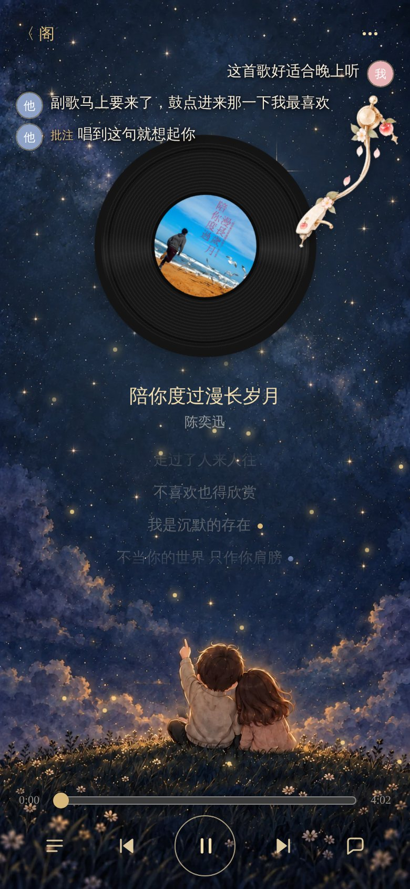
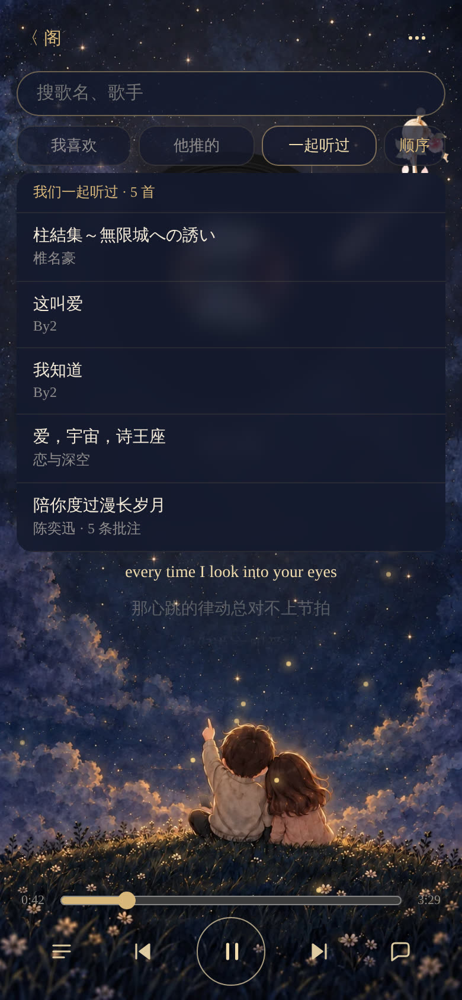

# 乐 · 一起听歌

一个人和一个 AI 一起听歌的小播放器：她听到哪，AI 就知道到哪；她在歌词旁写一句，AI 在旁边留一句。

<p align="center">
  
  
  
  
</p>

<sub>截图里的背景、唱臂、封面是使用者自己放的图；仓库不带任何图片，不放图也完整可用（纯 CSS 默认样式）。</sub>

## 和别的"一起听"有什么不同

市面上的"一起听"大多是人和人同步进度、再配个聊天框。这个是**人和 AI** 一起听，AI 像真人一样陪着：

- **AI 是真的"听"了**：多模态模型按段落听完整首歌——前奏什么乐器、副歌哪里情绪起来、人声什么状态，AI 都知道，不只是看歌词。
- **你听到哪，它才知道到哪**：没放到的段落不告诉 AI，不剧透；副歌进来那一刻它才"听到"，可以正好在那时候说话。
- **边听边聊，不打断音乐**：你随口说一句，它实时回你，话浮在星空上几秒淡出，不挡歌词。
- **歌词批注，会重逢**：你和 AI 都能在某一句歌词下写一句话；以后再放到这句，那句话会重新冒出来。
- **不绑任何一家 AI**：Claude、ChatGPT、DeepSeek、自己的 agent、手机上的 AI 助手，都能接。

## 有什么

- 唱片机、逐句歌词（可带翻译）、锁屏控制、五种按情绪换的氛围动效
- **替 AI 听歌**（可选）：多模态模型按段落听，AI 只知道已经放到的部分，不剧透
- 批注：点歌词写一句，AI 也能留一句，下次放到那句会冒出来
- **边听边聊（核心）**：你随口说一句，AI 实时回你，话带着头像浮在星空上、几秒后淡出；它还能跟着歌走——副歌进来、唱到某句时主动说话、在歌词下留批注，不挡歌词、不打断音乐
- 推歌：AI 推一首，页面顶上出卡
- AI 三种接法：OpenAI 兼容接口 / MCP（stdio + streamable HTTP）/ Webhook + REST

## 需要准备什么

- **必须**：一台能一直开着的电脑或服务器（Windows / macOS / Linux，Python 3.10+，无其他依赖）；一个 AI（Claude、ChatGPT、任何 OpenAI 兼容模型，或你自己的 agent）
- **音乐**：你自己的 mp3 / flac / m4a 文件 + .lrc 歌词。**不需要任何音乐平台账号**
- **可选**：阿里云百炼 key（让 AI 真的"听"）；一个公网隧道或反代 + HTTPS（手机出门也能用）

## 怎么装

**把 [AGENTS.md](AGENTS.md) 交给你的 AI，让它带你一步一步装。** 它写的就是给 AI 看的。

自己动手的话：
```
cp config.example.json config.json   # 改 passcode / api_token / names
# 把音乐放进 music/
python3 run.py                       # 打开 http://127.0.0.1:8807/
python3 tests/test_all.py            # 自测
```

## 许可

MIT
